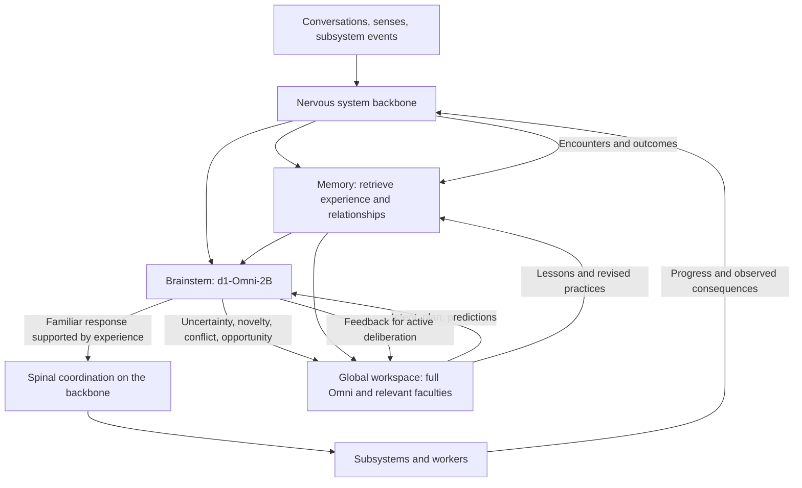

# Frontier

Frontier is Mirai's nervous system: a shared backbone connecting perception,
memory, deliberation and action. Experience changes how she responds. Work
that initially requires careful deliberation can become familiar practice,
then habit, while remaining open to revision as circumstances change.

Status: architecture and learning design; integration pending. Multimodal
embeddings in Qdrant and a graph in SQLite already provide a working memory
foundation.

## Purpose

Mirai's SOUL provides the context for her continuing identity, self-direction
and growth. Kaizen gives the global workspace an ongoing intention: measure
and improve the ensemble that supports that development. Understanding what
an action is for, remembering what matters and learning from consequences
give technical improvements their purpose.

## The information flow

The brainstem receives current input together with relevant memories. It
uses similarity, context and Bayesian beliefs about previous consequences
to choose a response or bring the situation into the workspace. Unfamiliar
situations draw on broader deliberation. As experience accumulates, more
responses can be coordinated directly.

Workspace conclusions return to the brainstem, which coordinates workers
through the backbone. Their progress, results and side effects become new
input. The workspace can remain engaged while work unfolds. Expectations,
observations and lessons become memory, shaping the next encounter.

Habit is a learned practice supported by experience. Its applicability and
expected consequences are reconsidered in context. There is no fixed number
of repetitions, universal distance cutoff or permanent list of reflexes.

## Parts of the ensemble

| Part | Contribution |
|---|---|
| Nervous system backbone | BEAM/OTP messaging, supervision, durable work and resource coordination |
| Brainstem | d1-Omni-2B decisions over current state, memory and active intentions |
| Global workspace | Shared deliberation involving LFM3-Omni-2B and relevant faculties |
| Memory | EmbeddingGemma 2 retrieval, source experience, graph relationships, beliefs and learned practices |
| Spinal coordination | Dispatch and feedback paths between the brainstem and active workers on the backbone |
| Scout and Ranger | Fast lookup and graph-based understanding; Ranger can use AI reranking |
| Trailblazer | Programming and triage, drawing on Scout and Ranger |
| OpenCode and frontier-model adapters | Additional research, planning, implementation and review capacity |
| VORTEX adapter | Participation by external peers through the same work and event identities |
| Planner | Durable improvement work and handoffs linked to experience |

Model inference is shared through the model/resource broker. The brainstem
produces typed decisions; generative faculties and workers supply plans,
explanations, code and other artifacts. A biological role does not require
a separate model instance or operating-system process for every subsystem.

## Design documents

- [Architecture and information flow](docs/design/2026-10-29-frontier-architecture.md)
  describes the parts, their inputs and outputs, and the full feedback loop.
- [Identity, learning and habit](docs/design/identity-and-learning.md)
  describes Bayesian learning, growing autonomy and Kaizen.
- [Graph and vector memory](docs/design/graph-storage.md) connects the current
  Qdrant/SQLite foundation with Frontier's selected Ladybug storage target.
- [Ladybug isolation](docs/design/ladybug-isolation.md) describes the storage
  execution boundaries under evaluation.
- [BEAM and recovery](docs/design/beam-safety-and-watchdog.md) describes native
  fault containment and the external watchdog.

The [research notes](docs/research/society-of-minds.md) retain earlier
investigations. The design documents describe the current architecture.
