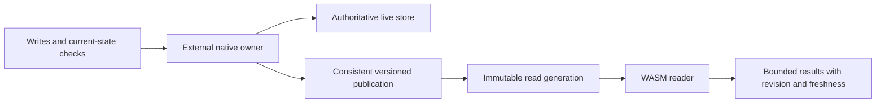

# Ladybug native crash containment

Selected engine: LadybugDB. Implementation task:
`frontier:5b8ac56` describes the external-worker candidate; compare execution
boundaries first under `frontier:89a29ee`. No adapter or engine recovery test
is claimed as deployed.

## Decision

Use an external native worker as the proven-boundary baseline, and evaluate
managed WASM and a native-writer/WASM-reader split as candidates below.
Ladybug is selected; the
final execution boundary remains subject to evaluation and deployment approval.
Do not load Ladybug's native engine as a NIF or linked-in port driver in
Frontier's main VM. An ordinary external Port
program is separate from a linked-in driver; similar names do not imply
the same isolation.

Erlang's documentation explicitly says NIFs execute as an extension of the
VM's native code and can crash or corrupt it. Dirty schedulers address
scheduling, not memory isolation. Hot code loading does not protect a
process from native memory corruption. This is a property of the binding,
not a requirement that Ladybug share BEAM's address space.
[NIF contract](https://www.erlang.org/doc/apps/erts/erl_nif.html),
[external Ports](https://www.erlang.org/doc/system/c_port.html).

The current `ladybug_ex` package is a NIF binding. It must not be used in
the main node just because its interface is Elixir. A Rust wrapper cannot
make unsafe C++ engine code memory-safe. A separate BEAM helper node could
contain that binding, but introduces another VM and binding-version
dependency. Prefer a narrow native helper using Ladybug's C API initially;
compare the helper-node alternative only if reuse materially reduces work.
[Package](https://hex.pm/packages/ladybug_ex),
[C API](https://api-docs.ladybugdb.com/c/lbug_8h).

## Worker and lifecycle

One worker owns one read/write Database object per store and creates
connections from that object. Do not run several writer workers on the
same file, or open an independent reader object alongside the writer.
Scale queries with connections/threads inside the owning worker and
bounded admission, not competing Database objects.
[Ladybug concurrency](https://docs.ladybugdb.com/concurrency/).

Production recommendation: a dedicated OS service unit contains the
worker and its resource limits; an OTP storage manager requests its
lifecycle and manages readiness/recovery. The unit has no competing
automatic restart policy: the manager owns backoff and failure escalation.
The worker does not share BEAM's memory-limit group. Normal application
or faculty restarts reconnect to the identified service rather than start
a second owner. Exactly one storage manager is admitted per store.

Use a filesystem Unix socket for production query traffic, with restricted
permissions and passive, bounded reads. A Port is suitable for a simple
prototype and demonstrates the same address-space boundary. Avoid an
active socket or unbounded native stdout feeding BEAM mailboxes. The
worker's logs are separately bounded; startup and supervision do not parse
unlimited log output as protocol.

Worker memory, CPU, thread/PID count and query concurrency have explicit
limits, leaving headroom for BEAM and models. Validate the effective
cgroup controls on this host, not just configuration text. Separate
address spaces contain direct native memory faults; they do not by
themselves contain host-wide OOM, disk exhaustion, malicious file writes,
or a kernel failure.
[OS resource controls](https://www.freedesktop.org/software/systemd/man/latest/systemd.resource-control.html).

## Protocol and API

Start with framed UTF-8 JSON and typed operations, not arbitrary executable
terms. Cap each frame before allocation, cap result pages/queue depth and
use demand/credit for pagination. Streams carry a request ID and cursor;
no unbounded full-graph response. Benchmark serialization before considering
a binary encoding. Do not create atoms from untrusted field values.

Handshake binds protocol/schema version, engine/extension version,
store UUID and worker generation. Requests include operation ID, scope,
input/graph revision, deadline and typed parameters. Responses distinguish
progress, page, committed receipt, rejection and failure. Unsupported
versions fail explicitly. Return an unavailable/error result rather than
an invented empty graph.

Serialize mutations in the worker; allow measured read concurrency. A
write's stable operation ID, argument hash and result receipt commit in
the same transaction as the mutation. Same ID/same arguments returns the
prior receipt; same ID/different arguments is rejected. The selected engine
must pass these transaction tests. No atomicity claim is made for arbitrary
external tools merely because database writes are transactional.

## Failure and recovery

On socket loss or worker death, stop admission and invalidate the old
worker generation. Unrelated BEAM processes stay running. Fail outstanding
reads as unavailable; classify unanswered writes as outcome-unknown.
Do not blindly retry them or treat a client timeout as a rollback.

Before replacement, verify that the old OS process/process group has
stopped and the store is exclusively available. Reopen the same store,
allow engine recovery, verify store/schema identity, inspect unresolved
operation receipts and perform a readiness probe. An existing receipt
resolves a committed write. A demonstrably absent receipt after successful
recovery permits an authorized retry with the same ID. Corruption or
failed recovery leaves storage unavailable, without an automatic empty
database, stale writer or endless restart storm.

Use per-connection query interruption when supported by the pinned C API.
If it does not complete, report that fact; replacing the whole worker is
an escalation that affects all in-flight connections and requires write
reconciliation. Parent shutdown, forced termination and application restart
must each have tested orphan handling. Changing engine binaries requires
drain, checkpoint, stop and reopen; Elixir hot upgrades can preserve the
client-facing interface without pretending to hot-swap native DB state.

## Why not compile Ladybug to BEAM bytecode?

The standard Erlang compiler accepts Erlang forms, Core Erlang and BEAM
assembly; it is not a general C++ target. There is no supported direct
Ladybug-to-BEAM build path established here. C++ pointers, mutable address
space, native threads and libraries do not acquire BEAM process isolation
merely by changing the artifact format. A wrapper that still calls native
Ladybug remains a NIF, with the same crash boundary.
[Compiler](https://www.erlang.org/doc/apps/compiler/compile.html).

A compiler/runtime could in principle emulate those facilities in managed
code, or the engine could be rewritten. That is a substantial compiler
or database project requiring new correctness/performance evidence, not
a mitigation needed to use the selected engine. WebAssembly could constrain
guest memory but would add a sandbox runtime; putting that runtime in a
NIF still includes its native implementation in the VM's trusted boundary.
No BEAM fork or engine rewrite is recommended for Frontier.

## Alternative: compile Ladybug to WASM and host it on BEAM

This alternative compiles Ladybug to WASM for hosting on BEAM. Wasm linear-memory
bounds checks can turn guest accesses outside that memory into traps;
host imports define access to files and other capabilities. Memory corruption
within guest memory can still break the database's own state. Sandboxing
is not transaction recovery or proof that a guest remains usable after a
trap. [Wasmtime sandbox model](https://docs.wasmtime.dev/security.html).

Ladybug already distributes WASM packages, but the documented variants use
Emscripten JavaScript glue, browser/Node workers and host-specific filesystem
integration. Default and threaded variants differ. A `.wasm` suffix does
not establish a compatible WASI ABI or disk semantics under an Erlang host.
[Ladybug WASM](https://docs.ladybugdb.com/client-apis/wasm/).

Two BEAM-hosted paths merit examination:

- Wasmex runs Wasmtime through a Rust NIF. Guest traps are intended to be
  contained, substantially reducing direct exposure to Ladybug C++ faults;
  runtime/host-call faults and resource exhaustion remain part of the trusted
  native boundary. It offers memory limits, which must be configured rather
  than assumed. [Wasmex](https://wasmex.hexdocs.pm/Wasmex.html),
  [limits](https://wasmex.hexdocs.pm/Wasmex.StoreLimits.html).
- `benoitc/erlang_wasm` documents an Erlang implementation with an optional
  filesystem NIF and a tier compiling hot functions through Core Erlang to
  BEAM. This is a research candidate, not a verified Ladybug host. Disable
  optional native components for the no-new-native-runtime comparison and
  assess the filesystem guarantees that are then lost. Pin source and version:
  the inspected documentation pages expose inconsistent version banners,
  and a similarly named old Hex package is a different project.
  [Runtime](https://erlang-wasm.hexdocs.pm/readme.html),
  [compiled tier](https://erlang-wasm.hexdocs.pm/compiled-tier.html),
  [security limits](https://erlang-wasm.hexdocs.pm/security.html).

Before choosing in-process WASM: inventory the actual module's imports,
WASI/Emscripten ABI, threads/atomics, exception/SIMD requirements and extension
availability. Demonstrate graph/vector queries, indexed updates, persistent
write/reopen, rollback/recovery after a trap, cancellation/fuel, total memory
limits including host allocations, and acceptable latency/throughput against
the same native worker workload. A caller timeout must not leave guest work
running unnoticed. Recreate a trapped engine instance unless its recovery
contract proves continued use safe.

An in-process Rust WASM NIF remains a candidate. Guest memory safety does
not make its native host infallible:
the runtime, binding and imports remain in the main node's trusted boundary.
The [application/native policy and external watchdog](beam-safety-and-watchdog.md)
make this distinction explicit. Running WASM in a separate OS worker is also
possible if both boundaries justify their cost. No Ladybug/WASM execution
test was run here; only the external native-fault probe below was run.

## Performance comparison: hypotheses to measure

Performance estimates require reproducible measurements of the selected
engine, host and workload. A runtime can
compile to native instructions while still incurring bounds, ABI, memory,
threading and host-call costs; the magnitude depends on the actual build.
Wasmtime offers an optimizing compiler and precompilation, so a universal
explanation that the JIT cannot spend time optimizing is insufficient.
[Execution tuning](https://docs.wasmtime.dev/examples-fast-execution.html),
[precompilation](https://docs.wasmtime.dev/examples-pre-compiling-wasm.html).

| Factor | Native external worker | In-process WASM host |
|---|---|---|
| Engine execution | Native engine build; benchmark actual query time | Runtime/build/feature dependent; no fixed native percentage |
| Results | Encode, bounded IPC and decode/term creation | Guest ABI, memory access/copy and decode/term creation |
| Scheduling | IPC/kernel overhead, amortized by batching | Runtime crossings plus host scheduling; avoid one call per row |
| Fault boundary | Direct worker native fault leaves main address space intact | Guest traps contained; native host failure can still lose main VM |
| Concurrency/persistence | Engine's native implementation within explicit limits | Must establish actual binding, module and filesystem support |

A NIF can access some BEAM data directly, but that is not zero-cost conversion
of arbitrary database rows. WASM linear memory is also not an Erlang heap:
Wasmex exposes reads as binaries, and application rows still need a defined
representation and ownership. Avoid claiming that in-process access eliminates
copying or term allocation. Ports are not intrinsically prohibitively
expensive; compare bounded batches and a reasonable encoding rather than an
unbounded JSON-per-row implementation.
[Wasmex memory API](https://wasmex.hexdocs.pm/Wasmex.Memory.html).

For the proposed Frontier workload, favor bounded key lookups, neighborhoods,
paths, top-k matches and aggregations. Keep bulk ingestion/indexing/scans in
the engine or stream bounded pages. This is a design target, not observed
production query statistics. It works with either boundary. Small results
reduce IPC costs; compute-heavy/small-result queries can therefore favor
native workers, contrary to a blanket recommendation to choose WASM for
aggregations. Large results require measured batching and conversion under
both integrations, not an assumption that IPC erases all native gains.

The comparison task must use identical data, answers, query limits and
controlled thread counts, then compare each tuned configuration. Include
lookups/top-k, heavy traversal with small output, paged large reads, ingestion
and vector mutation. Report cold/warm latency, p50/p95/p99 end-to-end latency,
throughput, CPU/RSS, result encode/copy/decode cost and main-loop
responsiveness. Confirm persistent write/reopen, trap recovery, resource
exhaustion and cancellation before considering performance a win. Keep both
execution options reviewable without reopening Ladybug selection.

## Hybrid candidate: native writes, WASM reads

This alternative selects the boundary by data-flow direction: writes
through the external native worker, reads inside WASM. Include this as a third
candidate under `frontier:89a29ee`; it need not be one runtime for every
operation. Native writes often return small receipts; local WASM reads might
avoid repeated result IPC. That is a plausible advantage to measure, not a
reason to assume replication or guest-to-BEAM conversion is free.

Ladybug currently permits one read/write Database object OR multiple read-only
Database objects for a database file. An independent WASM Database cannot
concurrently query the live file owned by the native writer, even if the host
process or filesystem lets it bypass the lock. It has its own buffer/transaction
state. Multiple connections to one Database object are a different case.
[Concurrency contract](https://docs.ladybugdb.com/concurrency/).

The candidate therefore needs a separately published, consistent read view:



For an initial proof, quiesce and close the writer before producing a distinct
immutable database copy, then reopen the live writer. This trades a measured
publication pause for a simple boundary. A documented online snapshot method
could replace it after verification. A checkpoint followed by an uncontrolled
copy of actively changing files is not an established snapshot protocol.
Ladybug's base file, WAL and checkpoint shadow state require attention.
[On-disk files](https://docs.ladybugdb.com/developer-guide/files/).

Prove native/WASM file-format, extensions, vector-index and filesystem
compatibility before assuming the same database copy is readable. Otherwise a
separately built read projection is possible but adds export/import and rebuild
cost. Do not invent a cross-runtime WAL replication API or share a native
Database pointer with the WASM guest.

Each published generation carries source store identity, schema/engine version
and a committed revision watermark. Readers open and validate a new generation
before switching; in-flight queries retain their old immutable generation.
Bound the number/size of generations. A failed refresh retains the last valid
view with explicit staleness, rather than claiming current data.

Authoritative claims, effect receipts and current preconditions stay at the
writer. A request that needs read-your-writes supplies a minimum committed
revision and waits for publication or reads through the native owner. Retrieval
may use an older view when its freshness contract permits it; revalidate before
an effect. A WASM read view cannot silently decide that a newly cancelled job
is still authorized.

Measure snapshot/projection bytes and time, write pause, refresh lag, duplicated
memory/disk, query conversion, tail latency and mixed read/write throughput.
Test write-followed-by-read, crash during publication, stale readers, index
parity and generation replacement. This split wins only if saved query-path
cost outweighs publication costs while meeting freshness needs. Shared-file
concurrent native writing/WASM reading would require engine-level changes and
new correctness evidence; it is not the initial integration assumption.

## Evidence and acceptance

On installed Elixir 1.20.4 / OTP 29, a disposable C helper was launched
through a packet-framed external Port. It answered a ping, then deliberately
raised SIGSEGV; a second instance called abort(). Core dumps were disabled.
Observed:

```text
segfault: worker exit=139; BEAM pid unchanged; unrelated Agent responsive, state=1
abort: worker exit=134; BEAM pid unchanged; unrelated Agent responsive, state=2
replacement worker answered in the same BEAM; retained state=2
probe_exit_code: 0
```

This establishes the existing OS boundary for those fault types. It does
not test Ladybug, production socket framing, automatic supervision, cgroup
limits, disk corruption or interrupted transactions. The probe sources
and output were generated in `/tmp/frontier-port-probe-lk1zdr4f` and are
disposable; the result and exact limits are retained here.

The implementation gate must additionally inject native engine faults,
hangs/kills, malformed/oversized output, parent restart and failures before,
during and after commit. Verify no competing writer/orphan, main BEAM
responsiveness/state retention, correct operation reconciliation and bounded
restart behavior. Run against a disposable database and pinned engine;
never fault-inject against Mirai's live memory.
